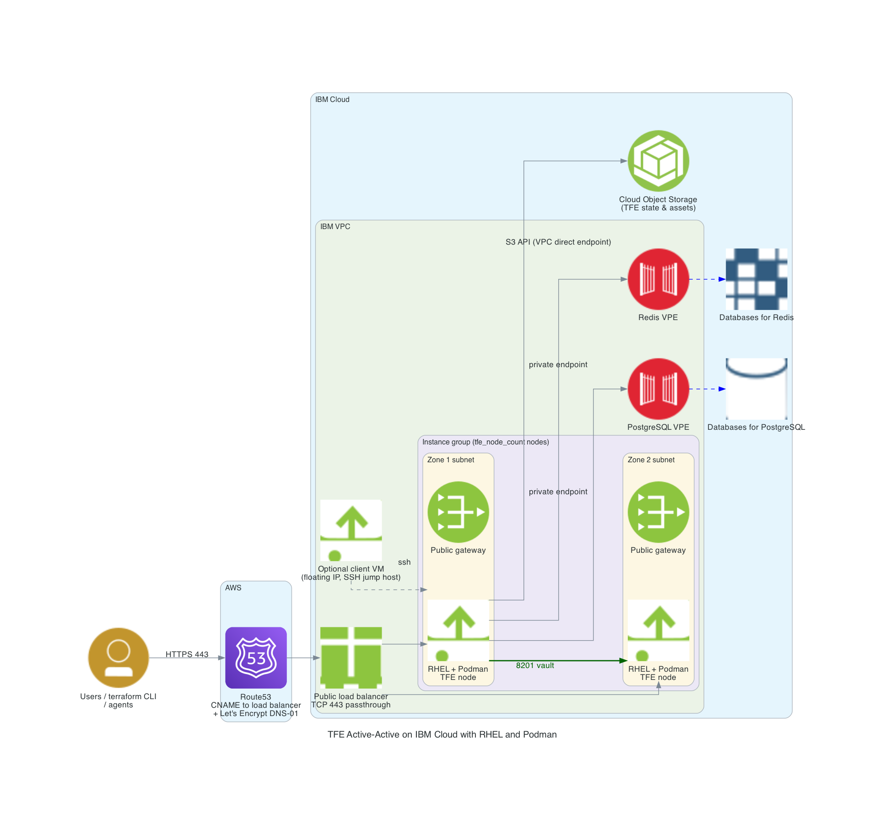

# Terraform Enterprise active/active on IBM Cloud with RHEL and Podman

With this repository you will be able to do a TFE FDO (Terraform Enterprise) online installation in active/active mode on IBM Cloud. TFE runs in a Podman pod on RHEL virtual servers (no Kubernetes cluster). The nodes sit behind a public load balancer and use managed IBM Cloud services for the external state: PostgreSQL, Redis and Cloud Object Storage.

The Terraform code will do the following steps

- Create a resource group, a Cloud Object Storage instance with a bucket and HMAC credentials used by TFE as object storage
- Create IBM Cloud Databases for PostgreSQL and for Redis, both reachable only over private endpoints
- Create a VPC network with a subnet and public gateway per zone, a network ACL, security groups and virtual private endpoints (VPE) for the databases
- Generate TLS certificates with Let's Encrypt (DNS-01 challenge in an AWS Route53 hosted zone) to be used by TFE
- Create a public load balancer (TCP passthrough on 443) and a Route53 CNAME record that points the TFE hostname to it
- Create an instance template and an instance group of RHEL servers. With cloud-init each node will
  - format and mount the data disk on `/var/lib/containers` and create a swap file
  - install Podman
  - create the required PostgreSQL extensions (`citext`, `hstore`, `pg_stat_statements`, `uuid-ossp`)
  - start TFE as a Podman pod managed by systemd (Quadlet)
- Optionally create a client VM with a floating IP. It is used as SSH jump host to the TFE nodes and has the Terraform CLI installed

# Diagram



The image is generated with the Python `diagrams` package: `python3 diagram/diagram_tfe_ibm_podman.py`


# Prerequisites

## IBM Cloud
We will be using IBM Cloud. Make sure you have the following
- IBM Cloud account with permission to create VPC, Databases, Cloud Object Storage and load balancer resources
- An IBM Cloud API key. Set it in the environment with `IC_API_KEY` instead of putting it in a file
- Install the IBM Cloud CLI (optional, handy to look up image names) [See documentation](https://cloud.ibm.com/docs/cli?topic=cli-install-ibmcloud-cli)

## AWS
AWS is only used for DNS (Route53) and for the Let's Encrypt DNS-01 challenge. Make sure you have the following
- AWS account with a Route53 hosted zone for your domain
- AWS credentials that may change records in that hosted zone

## Install terraform  
See the following documentation [How to install Terraform](https://learn.hashicorp.com/tutorials/terraform/install-cli)

## TFE license and image
- A Terraform Enterprise license
- Access to the TFE image. By default `images.releases.hashicorp.com/hashicorp/terraform-enterprise` is used with the license as password. For the IBM entitled registry set `tfe_image = "cp.icr.io/cp/ibm-terraform/ibm-terraform"`, `tfe_registry_username = "cp"` and `tfe_registry_password` to your entitlement key

## TLS certificate
You need to have valid TLS certificates that can be used with the DNS name you will be using to contact the TFE instance.  
  
The repo assumes you have no certificates and want to create them using Let's Encrypt and that your DNS domain is managed under AWS Route53. 

# How to

- Clone the repository to your local machine
```
git clone <url of this repository> tfe_fdo_ibm_podman
```
- Go to the directory
```
cd tfe_fdo_ibm_podman
```
- Set your IBM Cloud and AWS credentials
```
export IC_API_KEY=
export AWS_ACCESS_KEY_ID=
export AWS_SECRET_ACCESS_KEY=
export AWS_SESSION_TOKEN=
```
- Create a file called `variables.auto.tfvars` with the following contents and your own values. The file is ignored by git because it contains secrets
```
environment_prefix      = "tfe-ibm"                       # prefix for the names of all IBM Cloud resources
region                  = "eu-de"                         # Region to create the environment
dns_hostname            = "tfe-ibm"                       # DNS hostname for the TFE, the site becomes <dns_hostname>.<dns_zonename>
dns_zonename            = "aws.munnep.com"                # Route53 hosted zone to be used
certificate_email       = "patrick.munne@ibm.com"         # Your email address used by TLS certificate registration
tfe_license             = "<secret>"                      # license file contents
tfe_release             = "2.1.0"                         # Version number for the release to install. This must have a value
tfe_encryption_password = "Password#1"                    # identical on all nodes, do not change after the first start
ssh_public_key          = "ssh-rsa AAAAB3Nza"             # The public key for you to connect to the servers over SSH

# Optional
tfe_node_count          = 1                               # start with 1, set to 2 or more and apply again to scale out
letsencrypt_environment = "production"                    # "staging" gives an untrusted test certificate without rate limits
# create_client         = true                            # optional client VM with floating IP
# client_ssh_cidr       = "0.0.0.0/0"                     # restrict SSH to the client VM to your own address
```
- Terraform initialize
```
terraform init
```
- Terraform plan
```
terraform plan
```
- Terraform apply
```
terraform apply
```
- Terraform output should show you the public dns string you can use to connect to the TFE instance and the commands to reach the nodes
```
Apply complete! Resources: ... added, 0 changed, 0 destroyed.

Outputs:

client_ssh             = "ssh -i <private key> ubuntu@158.177.10.20"
configure_tfe_command  = "./scripts/configure_tfe.sh tfe-ibm.aws.munnep.com patrick.munne@ibm.com admin '<choose an admin password>'"
load_balancer_hostname = "xxxxxxxx-eu-de.lb.appdomain.cloud"
tfe_application        = "https://tfe-ibm.aws.munnep.com"
tfe_node_count         = 1
tfe_node_private_ips   = [
  "10.10.10.4",
]
tfe_node_ssh           = [
  "ssh -J ubuntu@158.177.10.20 vpcuser@10.10.10.4",
]
```
- The first node needs several minutes to install everything and for TFE to become healthy. Follow the progress on the node (`vpcuser` with sudo) in `/var/log/tfe-bootstrap.log` and `/var/log/tfe-postgres-init.log`, or wait for `https://<tfe hostname>/api/v1/health/readiness` to return OK
- Create the initial admin user and the organization `test` once, by running the `configure_tfe_command` from the output with your own admin password
```
./scripts/configure_tfe.sh tfe-ibm.aws.munnep.com patrick.munne@ibm.com admin 'your-password'
```
- To make it active/active, set `tfe_node_count = 2` (or more) in your variables and run `terraform apply` again. Only the instance group is changed, the running node is not touched. The nodes are spread over the zones and are added to the load balancer pool automatically
- You can now login to the application with the username admin and the password you specified when running `configure_tfe.sh`.
- To test the environment, use the code in the `test_code` directory. Change the hostname in the `cloud {}` block to your TFE hostname

# TODO

# Done
- [x] build network according to the diagram
    - [x] VPC with a subnet and public gateway per zone
    - [x] security groups for load balancer, TFE nodes, client and VPEs
- [x] use standard RHEL with Podman
- [x] create IBM Cloud Databases for PostgreSQL and Redis with private endpoints
- [x] create the PostgreSQL extensions from the nodes with retry and an advisory lock
- [x] Create a Cloud Object Storage bucket and HMAC credentials
- [x] create a public load balancer with TCP passthrough on 443
- [x] create an instance template and an instance group, scale with `tfe_node_count`
- [x] transfer files to the TFE virtual machines with cloud-init
      - license
      - TLS certificates
- [x] install TFE as a Podman pod managed by systemd (Quadlet)
- [x] Create a valid certificate to use 
- [x] point dns name to the load balancer
- [x] optional client VM with floating IP as jump host

# notes and links
[IBM Cloud VPC instance groups](https://cloud.ibm.com/docs/vpc?topic=vpc-creating-auto-scale-instance-group)  
[IBM Cloud VPC load balancers](https://cloud.ibm.com/docs/vpc?topic=vpc-load-balancers)  
[Terraform Enterprise on Podman](https://developer.hashicorp.com/terraform/enterprise/deploy/podman)
